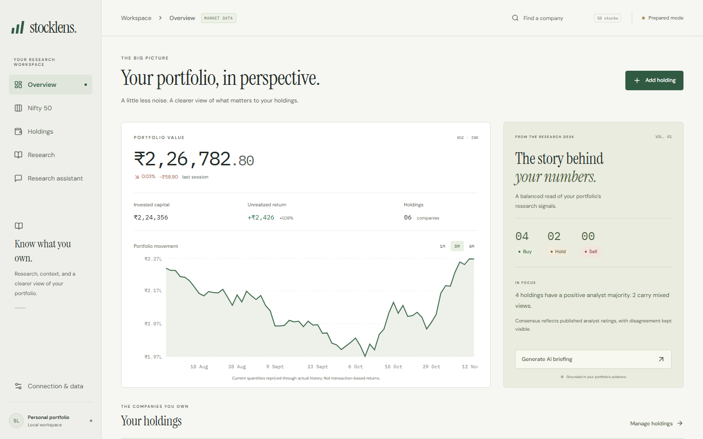
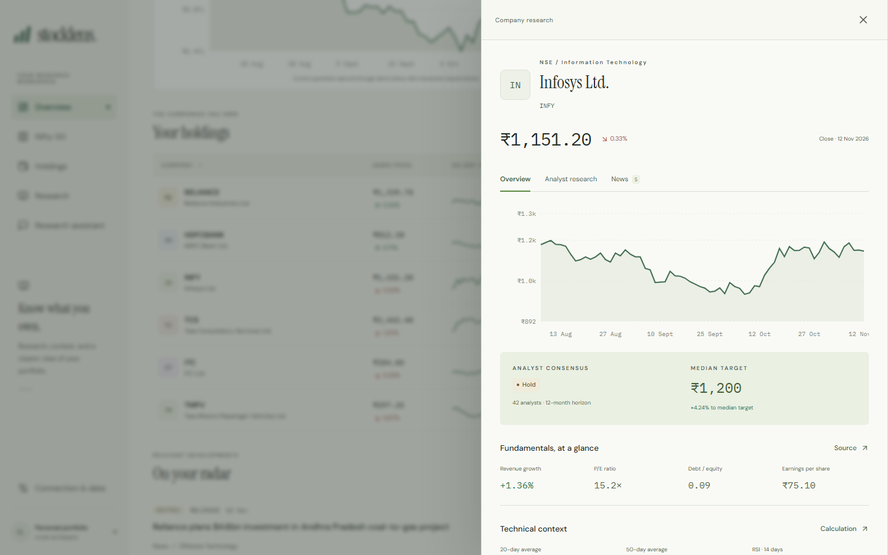
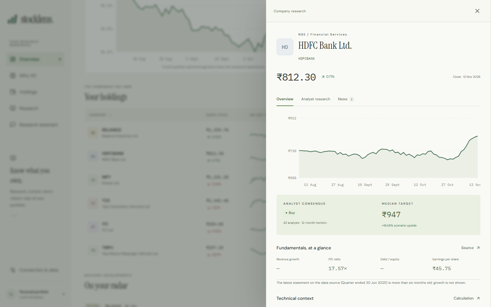

# StockLens

**A research workspace for the Nifty 50: real prices, reported financials, analyst consensus and news, explained by a local LLM that must cite the evidence it uses.**

   



Company research is scattered: prices in one app, results in a PDF, analyst views in another, news everywhere. StockLens puts them in one place for the 50 Nifty companies, computes the numbers in Python, and lets a self-hosted model explain them. Every model answer has to cite evidence records (`F-INFY` financials, `R-INFY-consensus` analysts, `N-INFY-2` news) that you can open.

> Educational project (B.Tech AI, Bennett University). Not investment advice.

## What it does

| | |
|---|---|
| **Real market data** | 1 year of daily prices for all 50 constituents; the latest reported quarter (revenue, net profit, year-on-year growth, margin), trailing P/E, ROE and debt-to-equity; analyst consensus (buy/hold/sell counts and target range); company news with publisher and link. |
| **Honest about gaps** | Companies that report in USD (e.g. Infosys) are converted to INR and labelled. Statements older than six months are flagged and their growth is not shown rather than guessed. Missing metrics show as "—" and are skipped in comparisons. |
| **Headline sentiment** | Every headline is scored by [FinBERT](https://huggingface.co/ProsusAI/finbert), a BERT model fine-tuned on financial text; low-confidence predictions are stored as neutral. |
| **Grounded AI explanations** | Qwen2.5-7B (self-hosted through Ollama) explains a stock, a comparison or the portfolio from a bounded set of evidence records. Answers must cite valid record IDs; if validation fails the app says so instead of showing an unsupported answer. |
| **Portfolio and comparison** | Holdings with P/L and sector weights; compare 2–4 companies on the same metrics, with notes when periods or sectors differ. |



<details><summary>How a stale statement is shown (HDFC Bank)</summary>


</details>

## Run it

```powershell
python -m venv .venv
.\.venv\Scripts\python -m pip install -r requirements.txt
npm ci && npm run build

.\.venv\Scripts\python -m backend.market_data      # import real data for the 50 constituents (~3 minutes)
# optional: headline sentiment (needs PyTorch)
pip install -r requirements-ml.txt && python -m backend.sentiment

.\.venv\Scripts\python -m uvicorn backend.main:app --port 8000   # http://localhost:8000
```

No API key is needed: data comes from Yahoo Finance's public endpoints (end-of-day, may be delayed). Re-run `backend.market_data` to refresh. Set `STOCKLENS_DATA=demo` to use the original offline fictional dataset instead (the tests use it).

### Original launcher and self-hosted LLM

Requires Python 3.11+, Node 22+, and an existing working `ssh chirag` alias.

```powershell
python -m venv .venv
.\.venv\Scripts\python -m pip install -r requirements.txt
npm.cmd ci
npm.cmd run build
```

For frontend development run `npm.cmd run dev`; Vite proxies `/api` to the backend on port 8000. The normal launcher serves the built frontend directly from FastAPI, so only one browser URL is required. Rebuild the frontend after source edits. Restart the backend after Python edits.

## LLM on chirag

The implementation installed an isolated user-local runtime under `~/stocklens_llm/` and pulled `qwen2.5:7b`. It does not modify system services or other projects.

```text
Browser → FastAPI on localhost:8000
        → localhost:11435
        → SSH tunnel to chirag
        → Ollama on chirag's 127.0.0.1:11435
        → qwen2.5:7b on the GPU
```

`scripts/connect-llm.ps1` starts the existing isolated runtime if needed and establishes a local-only tunnel. The remote model service remains running when local processes stop. It can be stopped on chirag by inspecting `~/stocklens_llm/ollama.pid` and terminating that specific owned process. GPU model memory unloads after the configured keep-alive period.

The first-time bootstrap script is `scripts/setup-remote-llm.sh`. To send it without Windows line-ending problems:

```powershell
.\.venv\Scripts\python -c "import subprocess,pathlib; subprocess.run(['ssh','chirag','bash -s'], input=pathlib.Path('scripts/setup-remote-llm.sh').read_bytes().replace(b'\r\n',b'\n'), check=True)"
```

Runtime configuration is read from environment variables described in `.env.example`; the file is an example, not automatically loaded. No paid API key is required. Connection status is checked against Ollama's model list. If the model is unavailable or output validation fails, stock explanations and briefings return labeled prepared responses. Chat clearly reports that a grounded answer could not be generated.

## What is implemented

- **Overview:** portfolio value, daily change, unrealized return, historical repricing chart, sector weights, research consensus, and portfolio briefing.
- **Holdings:** add, edit, remove, sort, filter, persistence, and CSV export.
- **Nifty 50:** searchable, sector-filtered 50-company catalogue; sortable financial metrics; compare two to four companies, inspect records, export CSV, and request a local-model explanation.
- **Research:** stock and sentiment filters, real headlines with publisher links and FinBERT tone, and evidence inspection.
- **Stock details:** price history, financial metrics, Wilder RSI, 20/50-day moving averages, divergent analyst reports, target ranges, and AI explanation.
- **Research assistant:** stock/portfolio-scoped questions with validated source IDs and inspectable sources. Questions are independent; earlier chat messages are not sent as context.
- **Connection:** truthful model status, local setup details, dataset assumptions, and API documentation.

## Data and analysis

**Universe.** The 50 constituents come from the [official NSE Indices CSV](https://www.niftyindices.com/IndexConstituent/ind_nifty50list.csv), pinned in `backend/fixtures/nifty50_constituents.csv`.

**Market data** (`backend/market_data.py`, Yahoo Finance via its chart endpoint and `yfinance`):

- Prices: one year of daily OHLCV; the price shown is the latest close.
- Financials: the latest reported quarter. Revenue and net profit are converted to INR crore; growth compares that quarter with the same quarter a year earlier; net margin = net profit / revenue; ROE and P/E are trailing twelve months; debt-to-equity is omitted for financial-services companies.
- Currency: if a company reports in another currency (Infosys reports in USD), figures are converted at the current Yahoo FX rate and the basis says so.
- Staleness: if the latest statement on the source is older than ~6 months (HDFC Bank at the time of writing), the record is flagged and growth is left blank.
- Analysts: buy (incl. strong buy) / hold / sell (incl. strong sell) counts and the low / median / high 12-month target. These are aggregated ratings; individual analyst reasoning is not available.
- News: up to five recent headlines per company, kept only if they actually mention the company, each with publisher and link.

**Sentiment** (`backend/sentiment.py`): FinBERT labels each headline positive / negative / neutral. On the first import: 108 positive, 26 negative, 34 neutral of 168. It scores the tone of the headline, not the company.

The raw data is not committed or redistributed; it is fetched on your machine. A one-off example portfolio (six holdings bought at the close ~6 months earlier) is created on the first full import; edit or remove it freely.

**Demo mode.** The original fictional dataset (`backend/seed.py`) is kept for offline use and tests: `STOCKLENS_DATA=demo`. Every label in the interface adapts to the active mode.

- Value = quantity × latest close.
- Unrealized P/L = value − quantity × average purchase price.
- Target upside = (median analyst target / latest close − 1) × 100.
- Buy or Sell consensus requires a strict majority of analysts. Otherwise Hold; no coverage means Unavailable.
- Portfolio history reprices **current quantities** over past closes. It is not a transaction ledger or time-weighted performance series.
- RSI uses Wilder smoothing; insufficient history returns null. A flat series returns neutral RSI 50.
- The LLM receives a bounded evidence context. Python computes metrics; reports supply opinions; the model explains them. Schema and source-ID checks reduce errors but do not prove every generated claim is supported.
- Briefings combine deterministic portfolio totals/consensus counts with a model-generated note on one focus holding (Sell consensus first, then portfolio weight). This avoids asking the small model to invent portfolio-wide comparisons. Sentiment-specific news questions first filter matching records in Python and list all matching symbols before the model narrative.

SQLite persists data and edits at `data/stocklens-real.db` (real mode) or `data/stocklens.db` (demo mode). Tests use a separate in-memory database for backend checks; browser tests temporarily create a holding and clean up afterward.

## Key endpoints

| Method | Endpoint | Purpose |
|---|---|---|
| GET | `/api/bootstrap` | Initial portfolio, stock universe, and news |
| GET | `/api/nifty50` | Pinned 50-company universe and financial comparison fields |
| POST | `/api/compare` | Deterministic comparison (`symbols`: two to four distinct constituents) |
| POST | `/api/compare/explain` | Local-model explanation using selected financial records |
| GET | `/api/portfolio` | Portfolio calculations and holdings |
| POST | `/api/portfolio/holdings` | Add a unique stock holding |
| PATCH / DELETE | `/api/portfolio/holdings/{id}` | Edit or remove a holding |
| GET | `/api/stocks/{symbol}/analysis` | Deterministic research view |
| POST | `/api/stocks/{symbol}/explain` | Grounded model explanation |
| GET | `/api/news` | Filtered news (symbol, sentiment) |
| GET | `/api/sources/{id}` | Evidence record |
| POST | `/api/portfolio/briefing` | Portfolio briefing |
| POST | `/api/chat` | Grounded question (`question`, optional `symbol`) |
| GET | `/api/health` | App identity and actual model availability |

## Verification

```powershell
$env:STOCKLENS_DATA='demo'; .\.venv\Scripts\python -m pytest -q   # 28 tests, offline
npm.cmd run build
npm.cmd run test:ui
node scripts\accessibility.mjs
.\.venv\Scripts\python scripts\smoke_llm.py
```

Browser tests use installed Google Chrome in headless mode and require the app running on port 8000. The model smoke test makes real requests through the tunnel. It checks explainability, disagreement, source resolution, and an unsupported weather question. Mocked browser tests separately exercise fallback presentation.

## Design

The implemented visual system is documented in `design.md`. It uses locally bundled DM Sans, Instrument Serif, and IBM Plex Mono, custom CSS, Lucide icons, and Recharts. It includes keyboard-accessible native dialogs, mobile navigation, meaningful empty/loading/error states, and reduced-motion support.

Product Design and Figma were discovered and offered as optional integrations, but were not connected during implementation. No claim is made that those services generated this UI.

## References

- Ollama manual installation: https://github.com/ollama/ollama/blob/main/docs/linux.mdx
- Ollama structured output interface: https://ollama.com/blog/structured-outputs

The app follows the documented local chat API and supplies a JSON schema for grounded answers.
